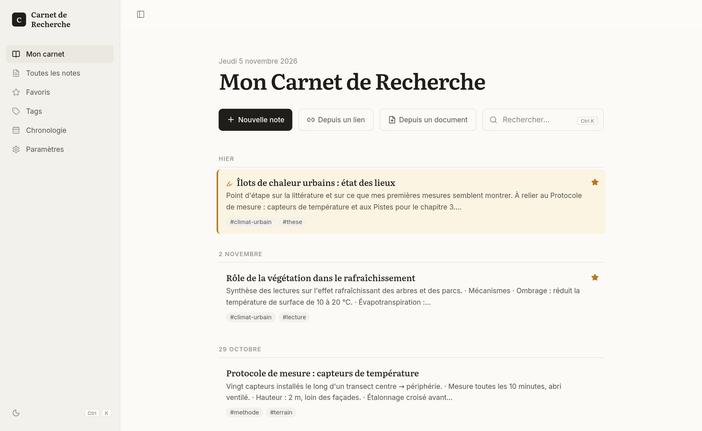
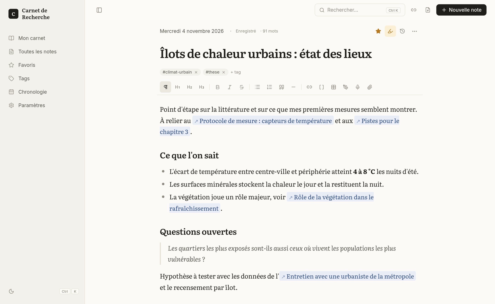
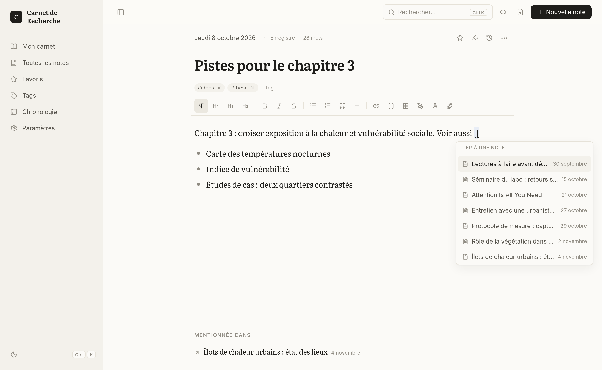
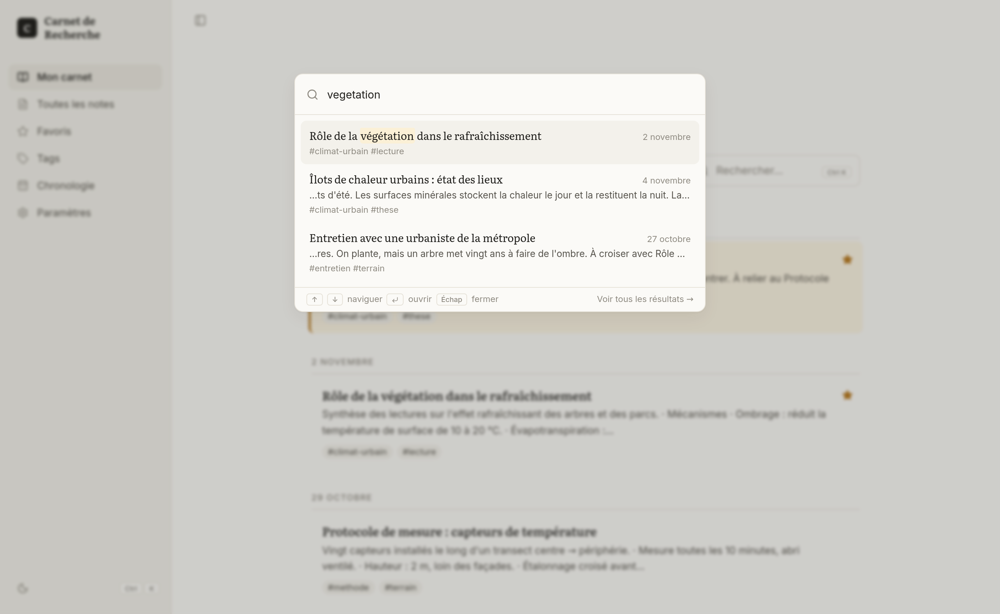
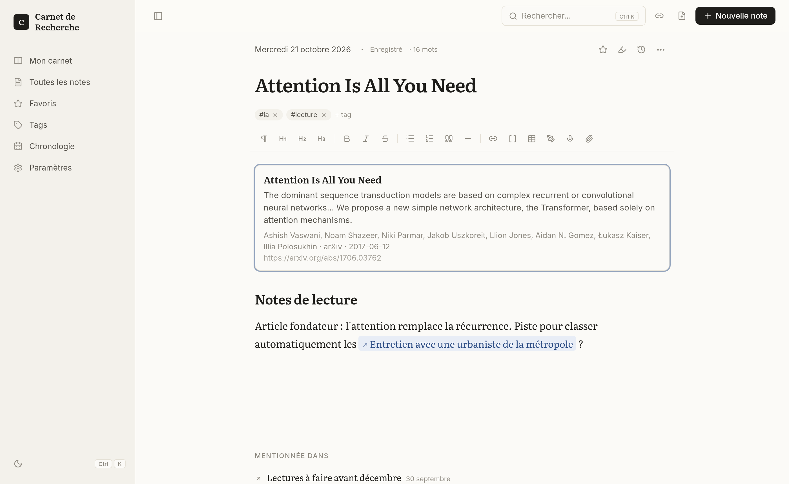
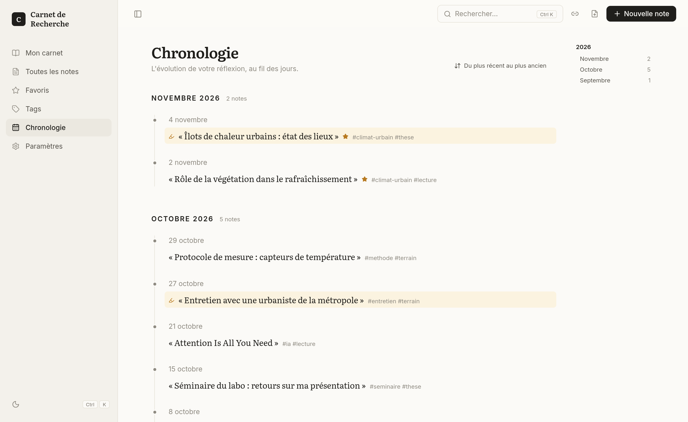

<div align="center">

# Mon Carnet de Recherche

**Un carnet de recherche numérique, sobre et entièrement local.**
Écrire, retrouver, relier ses notes, sans compte ni nuage.

<picture>
  <source media="(prefers-color-scheme: dark)" srcset="docs/captures/accueil-sombre.png">
  
</picture>

</div>

---

## Pourquoi ce carnet ?

- **Centré sur l'écriture** : on ouvre, on écrit. La sauvegarde est automatique.
- **Vos notes restent chez vous** : tout est enregistré sur votre ordinateur, dans un simple dossier.
- **Pensé pour la recherche** : notes de lecture, liens entre idées, références bibliographiques, chronologie de la réflexion.
- **En français**, en thème clair ou sombre, dans le navigateur ou en application de bureau (Linux, Windows, macOS).

## Aperçu

### Un éditeur confortable

Titres, listes, citations, tableaux, dessins à main levée, pièces jointes et enregistrements vocaux. Les notes importantes sont surlignées, les favoris marqués d'une étoile, et chaque version est conservée dans l'historique.



### Relier ses idées

Tapez `[[` pour lier une note à une autre. Chaque note affiche celles qui la mentionnent : votre carnet se transforme peu à peu en réseau d'idées.



### Tout retrouver en un instant

`Ctrl + K` ouvre la recherche dans les titres, le contenu et les tags, sans se soucier des accents ni des majuscules.



### Des notes de lecture en un clic

Collez l'adresse d'un article, un DOI ou un identifiant arXiv : le carnet récupère le titre, les auteurs, la revue, le résumé et prépare une note de lecture avec la référence mise en forme.



### Suivre l'évolution de sa réflexion

La chronologie présente toutes les notes, mois par mois.



### Et aussi

- **Fiches de révision** : à partir d'un PDF, d'un document Word, d'un fichier texte ou HTML, une fiche claire et expliquée (idées essentielles, notions clés, questions de compréhension), générée avec [Albert API](https://albert.sites.beta.gouv.fr/).
- **Vocaux transcrits** : enregistrez une idée à voix haute ; la transcription est ajoutée à la note et devient cherchable.
- **Exports** : chaque note en Markdown ou en PDF ; tout le carnet en Markdown (compatible Obsidian), en JSON ou en sauvegarde complète réimportable.

## Démarrer

Il vous faut [Node.js](https://nodejs.org/) 22 ou plus récent.

```bash
git clone https://github.com/nvagno/naoty.git carnet-recherche
cd carnet-recherche
npm install
```

### Dans le navigateur

```bash
npm run carnet
```

Ouvrez ensuite <http://localhost:3000>.

### En application de bureau

```bash
npm run electron     # ouvre le carnet dans sa propre fenêtre
```

Pour créer un installateur (AppImage et `.deb` sous Linux, `.exe` sous Windows, `.dmg` sous macOS) :

```bash
npm run dist         # les fichiers sont créés dans dist/
```

> L'installateur se construit sur le système visé : on prépare la version Windows sous Windows, la version macOS sous macOS.
> Si l'installation échoue en compilant SQLite, installez les outils de compilation : `sudo apt install build-essential python3` (Debian, Ubuntu), `xcode-select --install` (macOS), ou les « Outils de build Visual Studio » (Windows).

## Raccourcis utiles

| Action | Raccourci |
| --- | --- |
| Nouvelle note | `Ctrl/⌘ + N` ou `Alt + N` |
| Rechercher | `Ctrl/⌘ + K` |
| Enregistrer une version dans l'historique | `Ctrl/⌘ + S` |
| Lier une autre note | `[[` |
| Titre, liste, citation | `# `, `- `, `> ` en début de ligne |

## Vos données

Tout est rangé dans un seul dossier, indiqué dans **Paramètres → Où sont mes données ?** : la base des notes (`carnet.db`) et les pièces jointes (`uploads/`). Pour faire une sauvegarde, il suffit de copier ce dossier.

Le carnet fonctionne hors ligne. Il ne se connecte à Internet que lorsque vous le lui demandez : pour récupérer la fiche d'un lien ou d'un DOI, ou, si vous avez renseigné une clé Albert API (**Paramètres → Assistant IA**), pour créer une fiche de révision ou transcrire un vocal. Seul le document ou l'enregistrement concerné est alors envoyé.

## Contribuer

Les suggestions et corrections sont les bienvenues : ouvrez une *issue* ou une *pull request*. Pour lancer le carnet en mode développement : `npm run dev` ; pour les tests : `npm test`.

## Licence

Distribué sous licence [MIT](LICENSE).
